# Simple Radio 📻

  

Simple Radio is a lightweight internet radio app for Android. Search thousands of stations from the public [Radio Browser](https://www.radio-browser.info/) directory by name and country, save your favorites, and keep listening in the background with a sleep timer. It is built with modern Android practices: Kotlin, Jetpack Compose, an MVI presentation layer, Koin for dependency injection, and Arrow for functional error handling.

## 📸 Visuals

<table>
  <tr>
    <td align="center">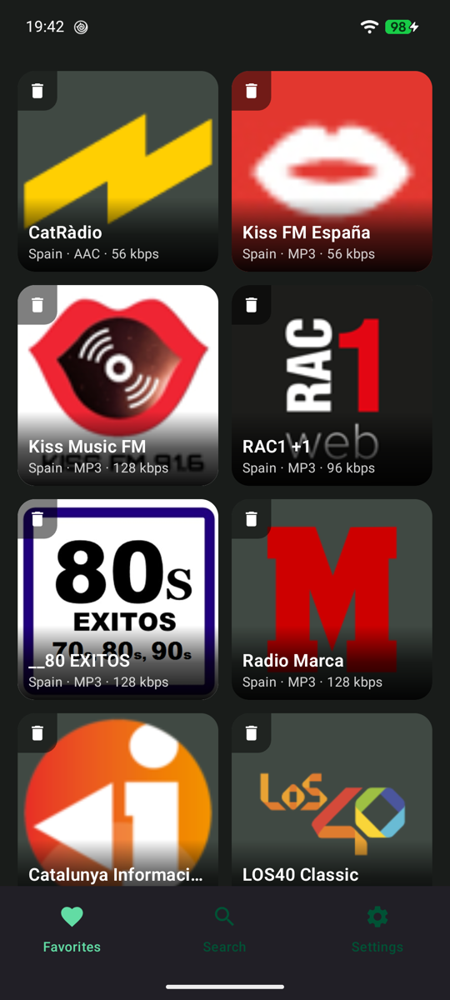 Favorites (dark theme)</td>
    <td align="center">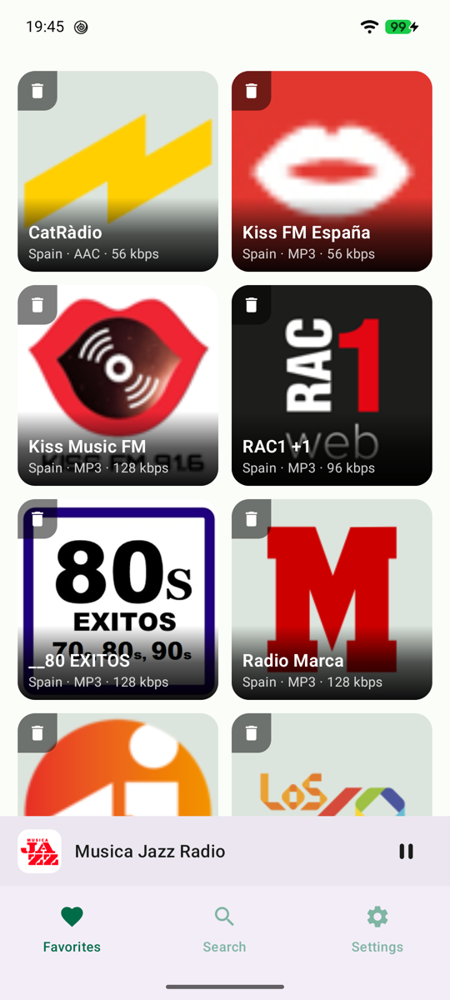 Favorites (light theme)</td>
  </tr>
  <tr>
    <td align="center">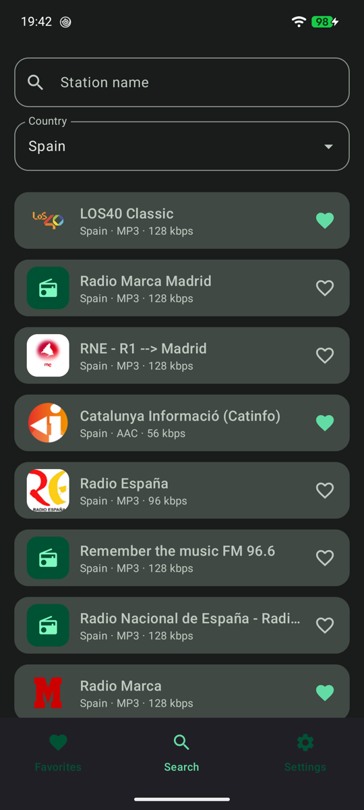 Search with default country</td>
    <td align="center">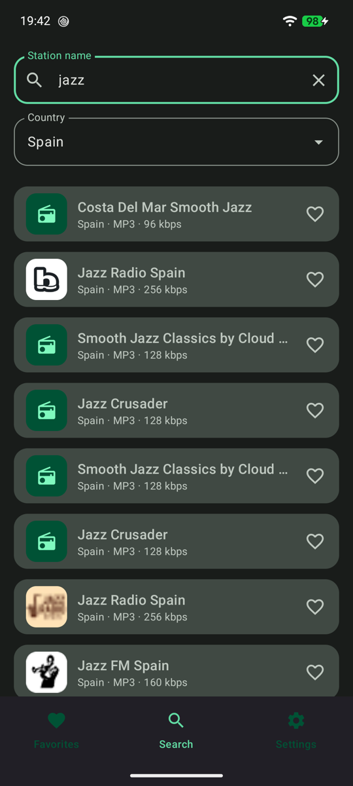 Search by station name</td>
  </tr>
  <tr>
    <td align="center">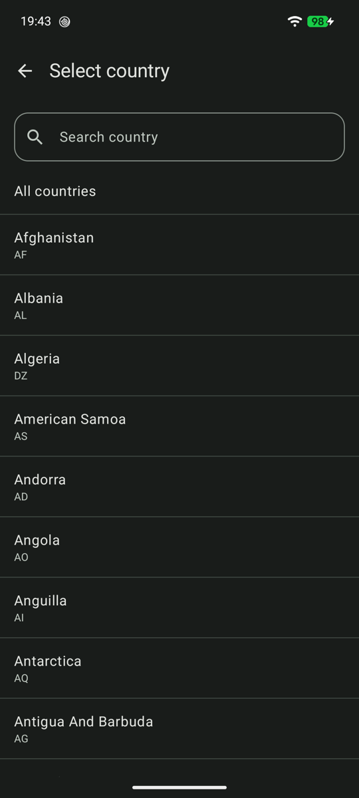 Country selector</td>
    <td align="center">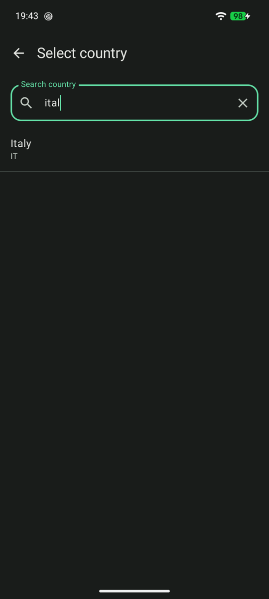 Country search</td>
  </tr>
  <tr>
    <td align="center">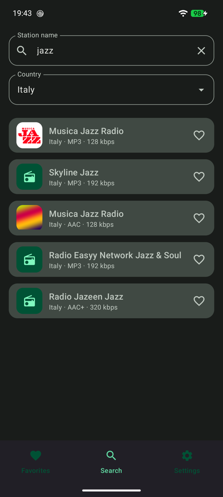 Results filtered by country</td>
    <td align="center">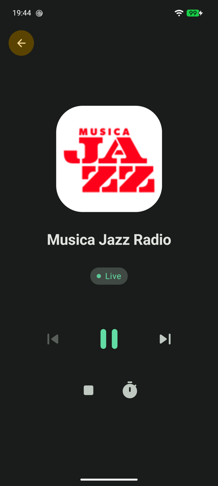 Full-screen player</td>
  </tr>
  <tr>
    <td align="center">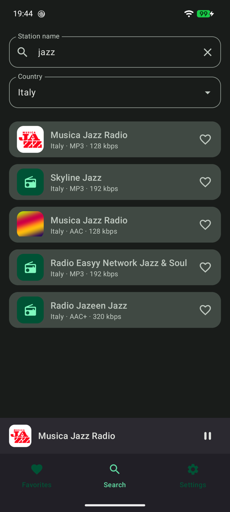 Mini player bar</td>
    <td align="center">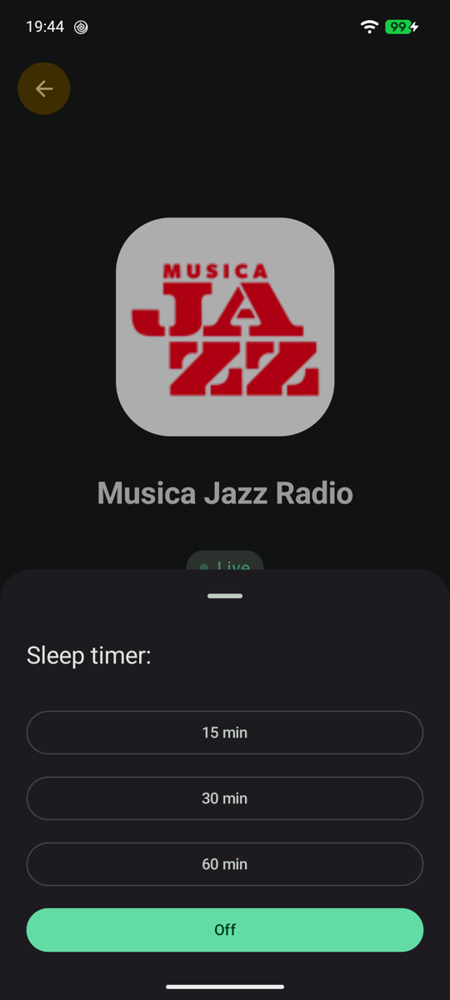 Sleep timer options</td>
  </tr>
  <tr>
    <td align="center">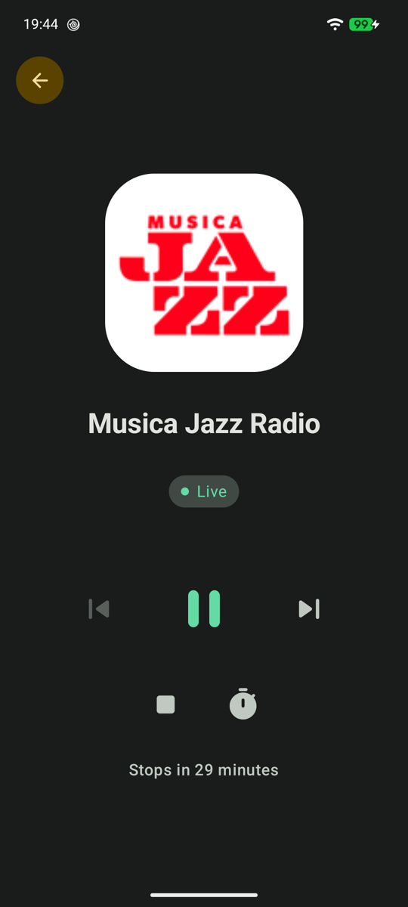 Active sleep timer</td>
    <td align="center">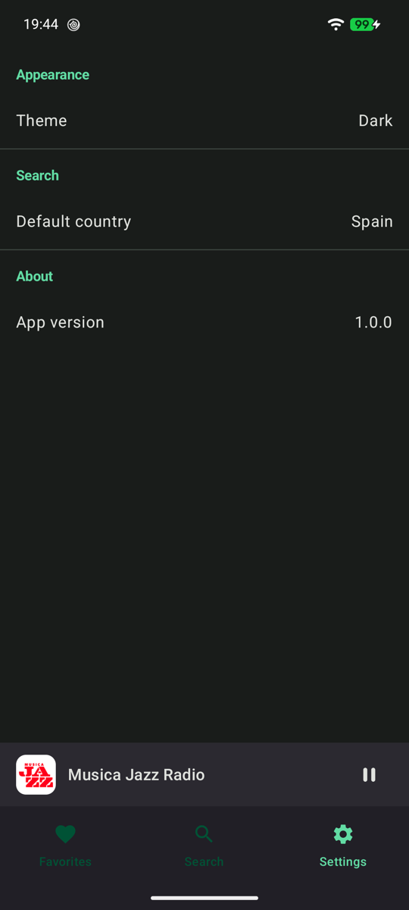 Settings (dark theme)</td>
  </tr>
  <tr>
    <td align="center">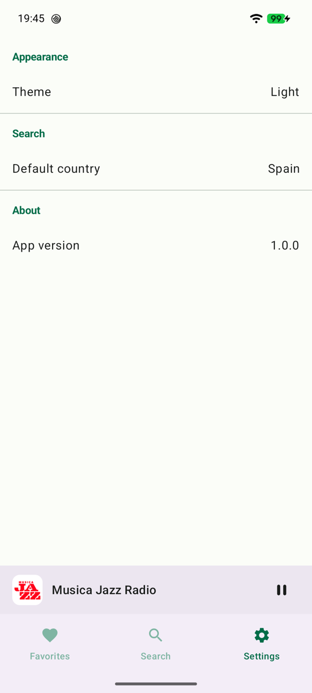 Settings (light theme)</td>
    <td align="center">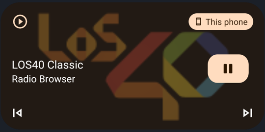 Media notification while playing</td>
  </tr>
</table>

## ✨ Features

- **Search stations by name** ([Search by station name](docs/images/search-by-name.png)): type part of a station name and get matching live streams with their country, format and bitrate.
- **Filter by country** ([Country selector](docs/images/country-selector.png), [Country search](docs/images/country-filter.png), [Results by country](docs/images/search-by-country.png)): pick any country from the list, or search within it to find it faster.
- **Default country** ([Settings](docs/images/settings-dark.png)): choose the country that is preselected when you open the search.
- **Favorites** ([Favorites](docs/images/favorites-dark.png)): add or remove stations with the heart icon in search results, and manage them in a grid with their artwork. Remove a station with the trash icon on its card.
- **Live playback** ([Player](docs/images/player.png)): play, pause and stop a station, and move to the previous or next station. The screen shows a *Live* indicator while the stream is playing.
- **Background playback with mini player** ([Mini player](docs/images/mini-player.png)): leave the player and keep listening. A bar above the navigation shows the current station and lets you pause it.
- **Media notification** ([Media notification](docs/images/media-notification.png)): while a station plays, the notification shade shows its name and artwork, with pause/play and previous/next controls, so you can manage playback without opening the app.
- **Sleep timer** ([Sleep timer options](docs/images/sleep-timer-menu.png), [Active timer](docs/images/sleep-timer-active.png)): stop playback after 15, 30 or 60 minutes, with a countdown on the player.
- **Theme selection** ([Dark](docs/images/settings-dark.png), [Light](docs/images/settings-light.png)): choose light, dark or system theme. The change applies immediately.
- **Offline awareness**: a banner warns when there is no internet connection, so you know why a station will not load.

## 🧭 Use cases

- **Find a station in a specific country.** Open *Search*, pick the country in the dropdown and type a name or genre such as "jazz".
- **Discover stations from another country.** Use the country selector to search the list and switch the results to that country.
- **Build a personal list.** Tap the heart on the stations you like and open *Favorites* to listen to them later from one place.
- **Listen while doing something else.** Start a station, go back to browse, and keep the stream playing with the mini player or the media notification.
- **Fall asleep to the radio.** Set a 15, 30 or 60 minute sleep timer and let playback stop by itself.
- **Set your preferred look.** Use light, dark or system theme and a default country that matches where you usually listen.

## 📚 Documentation

All project documentation lives in the [`docs`](./docs) folder.

* **[Project Setup Guide](./docs/SETUP.md):** Step-by-step instructions for configuring and running the app.
* **[End-to-End Testing Guide](./docs/E2E_TESTING.md):** How the E2E test suite is structured, how to run it, and the screen robot pattern.
* **[GitHub Guide](./docs/github.md):** Repository, CI workflows and the GitHub Actions used by the project.
* **Architecture Decision Records:**
  * [ADR 0001: Structured Coroutines Lint Integration](./docs/adr/0001-structured-coroutines.md)
  * [ADR 0002: End-to-End Testing Strategy & Architecture](./docs/adr/0002-end-to-end-testing-strategy.md)
  * [ADR 0003: Reactive Theming, Connectivity Monitoring, and ViewModel Patterns](./docs/adr/0003-reactive-theming-and-connectivity.md)
  * [ADR 0004: Deriving UiState with `stateIn` in ViewModels](./docs/adr/0004-ui-state-with-statein.md)

## ⚖️ Disclaimer

Simple Radio does not host, store or retransmit any audio of its own. The app only plays streams that broadcasters publish and that are listed in the public Radio Browser directory. All rights to station names, logos and audio belong to each radio station or its rights holders. This project is not affiliated with, endorsed by or sponsored by any of them.

## 🔗 Useful Links for Development

- [Kotlin Coding Conventions](https://kotlinlang.org/docs/coding-conventions.html)
- [Compose Lint Rules by Slack](https://slackhq.github.io/compose-lints/rules/)
- [Ktlint Rules by Pinterest](https://pinterest.github.io/ktlint/rules/standard/)
- [AndroidX Libraries Versions](https://developer.android.com/jetpack/androidx/versions)
- [Compose BOM Version Mapping](https://developer.android.com/jetpack/compose/bom/bom-mapping)
- [Jetpack Compose to Kotlin Compatibility Map](https://developer.android.com/jetpack/androidx/releases/compose-kotlin)
- [Google App Architecture](https://developer.android.com/topic/architecture/intro)
